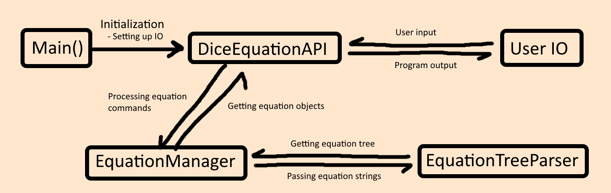

# Developer Documentation

## Table of Contents

- [Developer Documentation](#developer-documentation)
  - [Table of Contents](#table-of-contents)
  - [Probabilistic Number Library](#probabilistic-number-library)
    - [Interfaces](#interfaces)
    - [Exceptions](#exceptions)
    - [ProbabilisticNumber](#probabilisticnumber)
    - [Implemented Interfaces](#implemented-interfaces)
      - [Internal Representation](#internal-representation)
      - [Sampling](#sampling)
      - [Modifying the Distribution](#modifying-the-distribution)
      - [Serialization and Deserialization](#serialization-and-deserialization)
  - [Dice Number Library](#dice-number-library)
    - [Interfaces](#interfaces-1)
    - [DistributionDice](#distributiondice)
    - [UniformRangeDice](#uniformrangedice)
  - [Library Tests](#library-tests)
    - [Helper Classes](#helper-classes)
    - [ProbabilisticNumber Tests](#probabilisticnumber-tests)
      - [Construction Tests](#construction-tests)
      - [Probability and Value Modification Tests](#probability-and-value-modification-tests)
      - [Dictionary Conversion Tests](#dictionary-conversion-tests)
      - [Convolution and Operator Tests](#convolution-and-operator-tests)
    - [DiceNumber Tests](#dicenumber-tests)
      - [DistributionDice Tests](#distributiondice-tests)
      - [UniformRangeDice Tests](#uniformrangedice-tests)
  - [Dice Equation CLI](#dice-equation-cli)
    - [Structure Overview](#structure-overview)
    - [Command Parsing](#command-parsing)
      - [Parsing Logic](#parsing-logic)
    - [CLI Controller and I/O Handling](#cli-controller-and-io-handling)
      - [Command Parsing and Processing](#command-parsing-and-processing)
        - [Valid identifiers](#valid-identifiers)
    - [Equation Management](#equation-management)
      - [EquationManager](#equationmanager)
    - [Equation Object](#equation-object)
      - [Equation Evaluation](#equation-evaluation)
    - [Equation Tree Parser](#equation-tree-parser)
      - [1. Tokenization](#1-tokenization)
        - [Why doesn't the AST have parentheses nodes](#why-doesnt-the-ast-have-parentheses-nodes)
      - [2. Infix to Postfix Conversion](#2-infix-to-postfix-conversion)
      - [3. Tree Construction](#3-tree-construction)
    - [Abstract Syntax Tree Nodes](#abstract-syntax-tree-nodes)
      - [Abstract Classes](#abstract-classes)
      - [Literal Nodes](#literal-nodes)
      - [Arithmetic Operator Nodes](#arithmetic-operator-nodes)
      - [Dice Simulation Node](#dice-simulation-node)
        - [Evaluation](#evaluation)
        - [Calculating the distribution](#calculating-the-distribution)
  - [Dice Equation CLI Tests](#dice-equation-cli-tests)
    - [CommandParser Tests](#commandparser-tests)
    - [DiceEquationAPI Tests](#diceequationapi-tests)
    - [EquationManager Tests](#equationmanager-tests)
    - [EquationNode Tests](#equationnode-tests)
    - [EquationObject Tests](#equationobject-tests)
    - [EquationTreeParser Tests](#equationtreeparser-tests)

## Probabilistic Number Library

The probabilistic number library is a small library that provides classes and interfaces for working with probability distributions.
Currently, it only contains a single main class, aimed at representing a discrete probability distribution of numbers.

### Interfaces

Currently, only 3 interfaces are defined: `IProbabilityDistribution<T>`, `IDiscreteDistribution<T>` and `IUniformDistribution<T>`, where
the latter two implement the first one.
`IProbabilityDistribution<T>` should be the basis for all probability distributions implemented in the library, while the other two are more specific to discrete and uniform distributions respectively. Though they do not require any additional functionality, any classes that implement them should always follow the mathematical definitions of their interface.

### Exceptions

Only a single exception is defined: `ProbabilityException`. It should be thrown when a probabilistic method enters an invalid state, for example, when sampling from a distribution with a sum of probabilities less than 1.

### ProbabilisticNumber<T>

Represents a discrete probability distribution of numbers.

### Implemented Interfaces

The class implements the `IDiscreteDistribution<T>` interface, since that is its main purpose, but it also implements `IAdditionOperators`, `ISubtractionOperators`, `IMultiplyOperators` and `IDivisionOperators`. The operators are limited to combining two ProbabilisticNumber objects of the same type, effective applying the operator to two random variables.

Because these operators are supported, the underlying values of the distribution must also support them. For simplicity's sake, the type `T` is required to implement the whole `INumber<T>` interface, so any numerical modification of the values is supported.

#### Internal Representation

The values and probabilities are separated into two arrays. It is assumed that the array of values and probabilities are of the same length and that each index in the arrays corresponds to a value and probability pair.
The burden of maintaining the matching of indices between the arrays is left to the developer of any function modifying them.
Of course, the ordering itself does not need to be maintained, only the matching indices.

There are no safeguards that check that the sum of probabilities is truly 1. Constructing a distribution with a sum of probabilities less than or larger than 1 is valid behaviour.
No functions should assume that the sum of probabilities is 1, apart from functions sampling from the distribution.
If the sum of probabilities is less than 1 and a function requires working with a probability sum of 1, the function should either throw a `ProbabilityException` or
consider the missing probability as an error value, depending on the function's purpose.

#### Sampling

Sampling a value simply goes through the array of probabilities and subtracts them from a random number between 0 and 1, until the sum of the probabilities is more than or equal to the random number.
If the generated number is larger than the sum of the probabilities, an error is thrown instead.
This could occur in two cases:
- The random number is infinitessimaly close to 1 and precision problems occur when subtracting the probabilities.
- The sum of probabilities itself is less than 1.

The first situation is hard to avoid, and I believe the odds of it happening are small enough that throwing an error is an acceptable resolution.
The second situation is intended so that distributions can return something other than a value of the type they store.

#### Modifying the Distribution

The distribution implements basic operators to allow for easy combination of distributions, as if applying an operator to two random variables.
There are no operators for modifying the values of the distribution directly, so there isn't any potential confusion whether an expression like `distribution + 5` adds 5 to every value or adds 5 to the distribution.

Directly modifying the values is allowed through a `ModifyValues(Func<T, T>)` method, and any modification of internal fields should be done with similarly, disallowing direct access to the arrays.

Though a bit of a strange decision, removing values from the distribution and recalculating the weights so that their sum is 1 is separated into two different functions.
This is done to allow for removing unwanted values from the distribution and "replacing" them with an error instead, for example, if I only want to accept integer values from a distribution containing both integers and rationals.

#### Serialization and Deserialization

The first thing to note is that there may be duplicate values in the distribution.
Serialization and deserialization methods are allowed to aggregate the probabilities of duplicate values into a single probability.

The main serialization method is `ToDictionary()`, which returns a dictionary of values and their probabilities.
All other methods can be considered a different format of the same information.

For example, `ToDictionaryWithError()` returns a dictionary of values and their probabilities, but also includes an error value with the missing probability, if the sum is less than 1. Because of that, the key is no longer of type `T`, but is instead a string representing the value, or the string "error" for the error value.

`ToFormattedString()` returns a string representation of `ToDictionaryWithError()`, where it sorts the keys based on their value and formats the probabilities as percentages.
Ideally, the values would all be padded to the length of the longest value, but interpolated strings require constant value alignment. So, for simplicity, the values are either padded up to 5, 10 or 18 characters, depending on the length of the longest value.
These values were chosen because 5 allows for alignment with a possible `error` value, 10 is a nice middle ground and 18 is the maximum length of a double's string representation.
Large probabilities are written in standard 2-decimal fixed point formation, while small probabilities are written in scientific notation with 2 decimal places.

Deserialization is done through the `FromDictionary()` method, which takes a dictionary of values and their probabilities and constructs a new distribution from it.
Of course, other quick construction methods exist, if information is assumed about the distribution, for example, `FromUniform(T[] values)` and `FromUniformRange(long min, long max)`.

`FromUniformRange` is specifically limited to `int` and `long` inputs, since a range for non-integer types is not well-defined. Because of that, this method is limited to returning distributions of `int` and `long` types, while the other methods are generic and can return distributions of any type implementing the required `INumber<T>` interface.

## Dice Number Library

The dice number library is a small library that provides classes and interfaces for working with dice.
"Dice" isn't directly taken as possible physical dice, but simply any discrete probability distribution that can be "rolled" multiple times to sample from.

The rollCount of a dice object is the number of times to sample from the underlying distribution and sum the results,
thus it must be a non-negative integer (0 should be allowed).

### Interfaces

Only a single interface is defined: `IDice<T>`, which is the basis for all dice implemented in the library.
It implements the `IDiscreteDistribution<T>` interface, so all dice are expected to be discrete distributions.

### DistributionDice<T>

The `DistributionDice<T>` class is a generic dice class that can represent multiple "dice" rolls of a discrete distribution.
It is effectively a wrapper around the `ProbabilisticNumber<T>` class, where, upon construction, you can define how many times to "roll" the distribution and sum the results, when sampling from it.

Because of that, it can be easily converted to a `ProbabilisticNumber<T>` distribution, taking the base distribution and summing it `rollCount` times to itself. Though the original `DistributionDice<T>` object will be more memory efficient, since it does not need to store the full distribution of the summed values, but instead only the base distribution and the roll count.

### UniformRangeDice<T>

The `UniformRangeDice<T>` class aims at being a simple, memory-efficient dice class that can represent multiple "dice" rolls of a uniform distribution of a range of numbers.
The range is restricted to integer types, positive or negative, so only a `min` and `max` value is required when sampling, instead of iterating through every possible outcome.

Of course, when serializing to a dictionary or a formatted string, the probability of every value has to be calculated, so a shortcut is taken by first converting the range to a `ProbabilisticNumber<T>` and then serializing that instead.
Though it should be noted that the range of possible outcomes may be too large to be handled in memory efficiently, so care should be taken when constructing a `UniformRangeDice<T>` object with a large range of values.

## Library Tests

The LibraryTests project should contain all tests for the probabilistic number and dice libraries.
Because the libraries themselves are very small, all of the tests for a library were put together in a single test class.
This may be changed in the future if the libraries grow in size and class count.

Region tags separate test categories in each test class.

### Helper Classes

There is only a single helper class, implementing static methods for usage in tests.
Because the `IDiscreteDistribution<T>` interface does not define any equality comparison methods, the helper class implements a method to compare two distributions for equality, by converting them to a dictionary and checking the equality of the dictionaries.

Because the dictionaries are in the form of `Dictionary<T, double>`, the equality comparison of the values is done through the `Equals` method of the type `T`, while the equality comparison of the probabilities is done through a custom method that checks if the difference between two probabilities is less than a small epsilon value.

These helper methods are tested directly in the file, though their tests do rely on some basic functionality of the `ProbabilisticNumber<T>` class, so they are not fully independent.

### ProbabilisticNumber Tests

The tests for `ProbabilisticNumber<T>` are located in `src/LibraryTests/ProbabilisticNumberTests.cs` and are divided into the following regions:

#### Construction Tests
- **Valid Array Construction**: Verifies that constructing a `ProbabilisticNumber<int>` with equal-length value and probability arrays initializes the `Count` property correctly.
- **Mismatched Array Lengths**: Verifies that an `ArgumentException` is thrown if the value array and probability array have differing lengths.
- **Factory Methods**:
  - `FromDictionary`: Verifies that converting a dictionary of values and probabilities produces an identical distribution to direct array construction.
  - `FromUniform`: Verifies that an array of values is assigned uniform probability weights ($1 / N$ each) within a certain tolerance (due to floating point precision).
  - `FromUniformRange`: Verifies for both `int` and `long` that constructing ranges $[start, end)$ generates the correct integer sequence, where each value has equal probability ($1 / (end - start)$).

#### Probability and Value Modification Tests
- **Normalization**: Tests `Normalize()` by supplying unnormalized weights of higher and lower values, and verifying that the normalized probabilities sum to $1.0$.
- **Purging Values**: Tests `PurgeValues(Predicate<T>)` by removing subsets of values (or all values) matching a predicate, verifying that purged values are removed and other values are untouched.
- **Normalizing After Purge**: A more specific test of `Normalize()`, verifying that the common pattern of purging and normalizing works as expected.
- **Modifying Values**: Tests `ModifyValues(Func<T, T>)` by applying numerical functions, verifying that values are transformed while probabilities are untouched.

#### Dictionary Conversion Tests
- **Dictionary Conversion**: Tests that `ToDictionary()` is directly inverse to `FromDictionary()`, both containing the same values and probabilities. This also verifies that `toDictionary()` works as expected.
- **Missing Probability Dictionary Conversion**: Tests that `ToDictioanryWithError()` contains the probability missing to sum up to $1.0$ under the key `"error"`. This is verified for when the probability is missing on construction and when purging values.
- 
#### Convolution and Operator Tests
- All convolution is done through basic arithmetic operators `+`, `-`, `*`, and `/`.
- First, additive convolution is tested with distributions with a single value, verifying that the result is correctly combined.
- Then, every operator is tested with distributions of two values, verifying that both values and probabilities are correctly combined.
- The tests also verify that duplicate result values are aggregated and have their probabilities summed.
- Division tests are the only tests done with both `int` and `double` types

### DiceNumber Tests

The tests for the dice number library are located in `src/LibraryTests/DiceNumberTests.cs` and use `DistributionTestHelper` to verify probabilistic equivalences.

#### DistributionDice<T> Tests
- **Roll Count tests**:
  - Verifies that a roll count of 0 yields a single outcome of $0$ with a probability $1.0$.
  - Verifies a roll count of 1 results in the same distribution used on construction.
  - Verifies that a roll count of 2 results in a distribution that is the convolution of the base distribution and itself.
  - Verifies that a negative roll count throws an `ArgumentException` upon construction.

#### UniformRangeDice Tests
- **Roll Count tests**:
  - Verifies that a roll count of 0 yields a single outcome of $0$ with a probability $1.0$.
  - Verifies a roll count of 1 results in the same distribution used on construction.
  - Verifies that a roll count of 2 results in a distribution that is the convolution of the base distribution and itself.
  - Verifies that a negative roll count throws an `ArgumentException` upon construction.
- **Range Validation**: Validates that setting $min > max$ throws an `ArgumentException`.

## Dice Equation CLI

The Dice Equation CLI is a command line interface that allows for easy usage of the probabilistic number and dice libraries.

### Structure Overview

The application is structured into these components:
- Entry Point (`Program.cs`)
  - Writes a short welcome message and then simply constructs and runs the CLI API, setting its input and output to the console.
- CLI Controller and App API (`DiceEquationAPI.cs`)
  - Provides functions for each possible command and a `Run()` method to start the main loop.
  - Reads user input, using other classes to parse and process parts of the command unrelated to the program output.
- Command Parsing (`CommandParser.cs`)
  - Parses user input into a `Command` record struct, separating the command name and arguments.
- Equation Management (`EquationManager.cs`, `Equation.cs`)
  - Manages the equation storage, saving `Equation` objects under their identifiers.
  - Provides methods for retrieving, deleting, and enumerating saved equations.
- Abstract Syntax Tree (`EquationTreeParser.cs`, `EquationNodes/`)
  - `EquationNodes/` holds the classes for the nodes of the AST, together with their functionality.
  - `EquationTreeParser.cs` handles the parsing of the equation string into an AST.
- Probability Libraries (`ProbabilisticNumberLibrary`, `DiceNumberLibrary`):
  - Implements discrete random variables, arithmetic convolutions, and dice simulation classes.
  - Details can be found in their respective sections ([ProbabilisticNumberLibrary](#probabilistic-number-library), [DiceNumberLibrary](#dice-number-library)).

Here is a professional diagram of the application architecture:



### Command Parsing

Command parsing is handled by the static `CommandParser` class (`src/DiceEquationCLI/CommandParser.cs`).
The record struct `Command` is used to hold the parsed command name and arguments.

#### Parsing Logic
The input is split by whitespace (`' '`, `'\t'`) with `StringSplitOptions.RemoveEmptyEntries` into tokens, which are then trimmed of leading and trailing whitespace.
The first token is taken as the command name and the remainder as the argument list.
This means that when saving an equation, the user's equation will likely be split into multiple arguments.

### CLI Controller and I/O Handling

The public interface can be divided into two parts. The first part are the functions corresponding to each command, accepting any `string[]` as an argument.
The second part is the `Run()` method, which runs the main loop, reading user input and calling command functions with the parsed arguments.

Almost all input reading is done in `Run()` with the only exception being `PromptConfirmation()`, which is called when processing a large irreversible command (e.g. `del all` and overwriting a file with `export` ).

#### Command Parsing and Processing

Commands are stored in a `<string, Action<string[]>` dictionary, alongside a `<string, string>` help text dictionary, where the key is the command name.
Commands can only be added directly to each of these dictionaries.

All command functions accept a `string[]` argument, and each of them should call `AssertArgCount()` to validate the number of arguments. The only exceptions are `help` (since it's a good idea to print the help in that case) and `save`, which accepts any number of arguments, due to how command parsing works.

Supported commands include:
- `help`: Displays all registered commands with a basic introduction to each one.
- `exit`: Sets the internal `_exit` flag to terminate the main loop in `Run()`.
- `save <identifier> = <expression>`: Saves or overwrites an equation under a validated identifier
  - Whitespace around the identifier and expression is ignored, though currently to a possible extreme degree.
  - The current behaviour removes all whitespace from the whole string after the command keyword (e.g. `save a b c = 1 + 2/3` becomes `save abc=1+2/3` before validation) 
  - It may be changed in the future so that whitespace is initially preserved, with it only being removed from the expression after the original string is saved to the `Equation` object.
- `del <identifier> | all`: Deletes a specific equation or all of them.
  - `del all` prompts for confirmation before deleting all equations.
- `eval <identifier> | all`: Evaluates an expression and prints the sampled result.
  - Simply calls `Evaluate()` on the `Equation` object, the details of which can be found in the [Equation Evaluation](#equation-evaluation) section.
- `show <identifier> | all`: Displays the original equation string for specified or all stored equations.
  - The saved strings contain all original characters of the user input _excluding_ all whitespace.
    - So useless parentheses are kept (e.g. `()((1+2))`)
- `prob <identifier>`: Computes and displays the discrete probability distribution, mapping each value to its probability, sorted by numerical value
  - If the sum of probabilities is not $1.0$, the rest of the probability is accumulated to an "error" field
  - This whole process is not quite simple. The start of the explanation can be found in the [Equation Evaluation](#equation-evaluation) section.
- `export <filename>`: Writes all saved equations to a file.
  - Prompts for confirmation before overwriting existing files.
- `import <filename>`: Reads equations from a file, skipping empty and comment (`#`) lines and existing identifiers.
  - Importing should try to process the whole file, skipping over invalid lines, unless an error occurs that makes it impossible to continue.

##### Valid identifiers

Identifiers can only contain alphanumeric characters and underscores (`[a-zA-Z0-9_]`), but cannot start with a digit. They are case-sensitive.
`AssertValidIdentifier` throws an `ArgumentException` if the identifier is not valid, with an error message explaining the problem.

### Equation Management

#### EquationManager
`EquationManager` (`src/DiceEquationCLI/EquationManager.cs`) maintains the collection of equations in a `Dictionary<string, Equation>`.
`AddEquation(name, equation)` accepts the equation as a string, offloading the parsing to `EquationTreeParser`, so any parsing errors should either be rethrown or propagated to the caller.

`GetEquation(name)`, `HasEquation(name)` and `DeleteEquation(name)` all throw an `ArgumentException` if the equation does not exist.

`ClearEquations()` and `EnumerateEquations()` are the only methods that work directly on the whole dictionary.

### Equation Object

The `Equation` object (`src/DiceEquationCLI/Equation.cs`) stores all information relevant to an equation:
- `Name`: The equation identifier.
- `_equation`: The original source equation string (returned by `ToString()`).
- `_equationTree`: The compiled AST root node (`Node`).
- `_distribution`: The cached `IDiscreteDistribution<double>` (constructed as `ProbabilisticNumber<double>`).
- `_evaluateDistribution`: A possible optimization flag.

Only the `_equation` string is required on construction, everything else is set later with methods.
The main methods of the class are `Evaluate()` and `GetDistribution()`, which change their behaviour based on past actions.

#### Equation Evaluation

The expected pipeline is as follows:
1. The `Equation` object is constructed and its name and equation tree are set.
2. Whenever `Evaluate()` is called, the whole AST is evaluated and the result is returned.
  - This is typically fast because the evaluation of each node is relatively fast.
3. Later, `GetDistribution()` is called to compute the exact discrete probability distribution of the subtree.
  - This can be incredibly slow if the distribution has a lot of possible outcomes and a few specific reasons. More details can be found in the [Dice Simulation Node](#dice-simulation-node) section.
  - Because of this, the distribution is only computed once and cached.
4. Despite the distribution being cached, it may still be faster to evaluate the whole AST (e.g. in the case the equation has a few dice nodes, but a lot of possible outcomes)
   - So a heuristic is used to mark whether `Evaluate()` should sample the distribution or evaluate the AST.
   - Because a single outcome of the distribution is cheaper than a node of the AST, the flag is set to trigger when `AST Node Count > (distribution outcome count / 2)` is true.
5. Now both `Evaluate()` and `GetDistribution()` calls should be fast.

In an ideal world, this strategy would be further refined so that the AST would include distribution nodes, so then parts of the tree with a small number of possible outcomes would be compiled into a single small distrubtion. And then these small distributions would be sampled, instead of convoluting them into one enormous, slow-to-sample distribution.
But such an algorithm was deemed too unnecessarily complicated when the main problem is equations having too many possible outcomes.

### Equation Tree Parser

This was a very fun class to write (this statement can be taken as both sarcastic and genuine).

`EquationTreeParser` (`src/DiceEquationCLI/EquationTreeParser.cs`) parses infix mathematical and dice expressions into an AST.
The parser is capable of working with any binary and unary operators, as long as it is given a symbol, priority, and a function to construct an AST node of that operator.

It saves the information in an `EquationOperator` object, which it saves in either the `_binaryOperator` or `_unaryOperator` dictionary.
This means that the uniqueness of the symbol of each operator applies only among the same parity.

Here is a table of the operators added during construction:
| Symbol | Arity  | Priority | Node Class           |
| ------ | ------ | -------- | -------------------- |  |  |
| `d`    | Binary | 10       | `DiceSimulationNode` |
| `-`    | Unary  | 10       | `NegationNode`       |
| `*`    | Binary | 5        | `MultiplicationNode` |
| `/`    | Binary | 5        | `DivisionNode`       |
| `+`    | Binary | 3        | `AdditionNode`       |
| `-`    | Binary | 3        | `SubtractionNode`    |

The main parsing of equations is divided into three functions: `EquationToTokens()`, `InfixToPostfix()` and `ConstructTree()`.
`ConstructTree()` is the only public function, so it accepts the original string and then calls the other two functions on it.

#### 1. Tokenization

`EquationToTokens(string equation)` splits an equation string into lexical tokens.
Because the main AST does not have a node for parentheses and some other reasons ([explanation here](#why-doesnt-the-ast-have-parentheses-nodes)), the tokens aren't in the form of an AST, but are instead simply substrings of the original equation.

The function iterates through every character of the equation, ignoring whitespace and taking notice only of operator symbols (both binary and unary) and parentheses.

Ignoring all whitespace, whenever a non-operator or parentheses symbol is found, it is added to a `token` string. Then, when an operator or parentheses is found, the `token` string and the found operator or parentheses are added separately to the list of tokens, and then the `token` string is cleared.  

So basically every operator symbol and parentheses is its own token, and then every string (ignoring whitespace) between such tokens is its own token.

##### Why doesn't the AST have parentheses nodes

The main AST was meant to be the node tree capable of evaluation, so every `Node` must implement `Evaluate()`. However, parentheses don't have a place in an AST tree, nor do they have a reasonable implementation of `Evaluate()`.
So, parentheses nodes would either only be used for a short section of the tree construction, whilst not being properly defined nodes, or a whole second AST would need to be added, containing only enums/symbolic nodes.

I didn't find either of these solutions to be good. The first because of the improper implementation, the second due to that large number of near-duplicate classes, just for two functions in equation parsing.
So instead I opted for a third, slighly less bad option, where tokens were simply kept as strings.

Of course, this method has pros and cons. The pros being every character is technically a valid token, so even scientific notation of numbers is accidentally supported! The word _accidentally_ being crucial here, since it isn't officially supported and negative exponents aren't parsed correctly. On the other hand, the cons are, of course, that no validation of the equation characters is done at all in this function and is instead offloaded to other functions.

#### 2. Infix to Postfix Conversion

`InfixToPostfix(string[] tokens)` is an implementation of the Shunting-Yard algorithm using an operator stack and a postfix token output list:
 
It has one interesting characteristic. Despite differentiating between binary and unary operators, it doesn't actually validate the context of the operator to make sure it has operands.
To be more specific, binary and unary operators are differentiated by keeping track of an `expectUnary` flag and the existence of the current token in the unary operator dictionary.

The `expectUnary` flag is set to `true` whenever the last token was nothing, an operator, or an opening parenthesis.
You can realize that these are the only situations where a valid equation would have a unary operator, so for valid equations, this does not pose any problem.
However, it means that in some very specific invalid equations, the returned error depends on whether the operator is just binary or binary and unary:
```bash
> save a = 1 (-) 1
Invalid equation format: Too many operands or missing operators.
> save a = 1 (+) 1
Missing operand for binary operator '+'
```

Apart from that, the function also follows operator priorities, throws an `ArgumentException` with a message on mismatched parentheses and invalid tokens, and it prefixes the tokens of unary operators with `"u"`, so that they can be easily differentiated and validated during tree construction.

#### 3. Tree Construction

`ConstructTree(string equation)` builds the AST from the original equation string.
First it calls `EquationToTokens()`, checks the equation isn't empty, and then it calls `InfixToPostfix()`.

Then, working with the postfix tokens, it constructs the tree, saving the highest level nodes in a `Stack<Node>` and popping them as they are processed, throwing an `ArgumentException` if an operand is missing for an operator and an `InvalidOperationException` if the operator AST node construction function returns null.

### Abstract Syntax Tree Nodes

AST nodes can be found in `src/DiceEquationCLI/EquationNodes/`.

#### Abstract Classes

- `Node`: Base class defining two abstract methods:
  - `double Evaluate()`: Evaluates the subtree and returns a result.
  - `ProbabilisticNumber<double> GetDistribution()`: Computes and returns the discrete probability distribution of the subtree.
- `ValueNode`: Abstract base for leaf literal nodes.
- `UnaryNode`: Abstract base for single-child nodes. Only allows a single assignment of a `Child` (throws `InvalidOperationException` if re-assigned).
- `BinaryNode`: Abstract base for two-child nodes (`Left`, `Right`). Only allows a single assignment of `Left` and `Right` (throws `InvalidOperationException` if re-assigned).

#### Literal Nodes

- `IntegerNode(long Value)` / `DoubleNode(double Value)` (`LiteralEquationNodes.cs`):
  - `Evaluate()` returns the constant numeric value.
  - `GetDistribution()` returns `ProbabilisticNumber<double>.FromUniform([Value])` (a deterministic discrete distribution with a single value and probability $1.0$).

Currently only `DoubleNode` is used, since `Evaluate()` has to return a `double` anyway.

#### Arithmetic Operator Nodes
- `AdditionNode`:
  - `Evaluate()`: `Left.Evaluate() + Right.Evaluate()`
  - `GetDistribution()`: `Left.GetDistribution() + Right.GetDistribution()` (distribution convolution)
- `SubtractionNode`:
  - `Evaluate()`: `Left.Evaluate() - Right.Evaluate()`
  - `GetDistribution()`: `Left.GetDistribution() - Right.GetDistribution()` (distribution convolution)
- `MultiplicationNode`:
  - `Evaluate()`: `Left.Evaluate() * Right.Evaluate()`
  - `GetDistribution()`: `Left.GetDistribution() * Right.GetDistribution()` (distribution convolution)
- `DivisionNode`:
  - `Evaluate()`: Evaluates left and right; throws `DivideByZeroException` if `Right.Evaluate() == 0`.
    - Divide by zero is handled manually, because otherwise for `double`s, it would just result in positive infinity.
  - `GetDistribution()`: Purges all `0` values from the right distribution (converting division-by-zero into error probability), then computes `Left.GetDistribution() / right`.
- `NegationNode`:
  - `Evaluate()`: `-Child.Evaluate()`
  - `GetDistribution()`: `distribution.ModifyValues(value => -value)`

#### Dice Simulation Node

The `DiceSimulationNode` represents the dice rolling operator `XdY` where $X$ is the roll count and $Y$ is the number of sides.

##### Evaluation

In theory, to evaluate a dice node, all that is required is evaluating the left and right children, constructing a new `UniformRangeDice` and sampling.
However, in practice, the sampling algorithm of `UniformRangeDice` is simple, so the function skips the construction step and directly samples a `Random` object for every dice roll.

Not to mention, because the evaluation of the left and right children doesn't have to be deterministic, if a `UniformRangeDice` were constructed, it couldn't be cached, because the roll count and dice sides could be different.
But when directly sampling a `Random` object, we only need arithmetic to manipulate the result to be within the dice range, so we can construct just one `Random` object in the nodes lifetime, and use it whenever evaluating.

As for the actual sampling, the value of both the left and right children must be non-negative and integers.
If the right child has a value larger than a 64bit integer, an error is thrown, though because all numbers in the input are parsed as `double`s, the precision causes the limit to be a bit smaller, so the error displays the value formatted as a `double`.

It was also decided that the summing of sampled values would be checked, so it will overflow on an error, though this _should_ be impossible, as the number of dice sides must fit within a 64bit integer and the result sum is a `double`.

##### Calculating the distribution

This is where the fun starts.

One must consider that the number of possible outcomes an equation can have grows exponentially to its length.
Consider the expression `2d2d2d2`. The first node has 3 possible outcomes, the second then can be `2d2`, `3d2`, `4d2`, and the final one has even more. Thankfully, with such small numbers, the overlap on the possible values is large, being in the range of $[4, 8]$, however, the exponential nature is there.

Not to mention, the calculations of the function itself are quadratic, in addition to processing an exponential number of values.
This function has to iterate through every value of the left child's distribution, and for every possible value, it has to iterate through the right child's distribution. And for **each** of the pairs, it has to construct a `UniformRangeDice` with the pair of values as the roll count and die's side count, and then for each value of _this_ distribution, it has to add its probability to the dictionary containing the final results for this node.

Thankfully, any probability errors (probability sums $< 1.0$) propagate by themselves and will appear in the final result, so there is no need to trouble ourselves by having to work with `ToDictionaryWithError()` and convert the strings back to doubles.
This also helps with the fact that we only need to consider non-negative integers as possible values for the left and right distribution, so we can purge all unfit values (and hope that it removes most of them).

Since this function can be incredibly slow, it is a prime position for parallelization, at least as a bandaid patch. For that reason, the final dictionary is instead a `ConcurrentDictionary` and the outermost loop is parallelized with `Parallel.ForEach`. To reduce contention, the calculations within the outermost loop are done in a local dictionary, only passed to the concurrent dictionary at the very end.

Though a basic parallelization approach, it saw a relatively large speedup. Unfortunately, due to the cubic nature of the iteration over all the possible values in every situation, once an equation reaches around 2000+ possible outcomes, the speed of `GetDistribution()` becomes slow enough to be unfriendly to the user.

## Dice Equation CLI Tests

Unit tests for the CLI application are implemented in the `DiceEquationCLITests` project (`src/DiceEquationCLITests/`) using xUnit.
Each class has its own file of tests. Within those files, region tags divide test categories.

### CommandParser Tests

There are only two small tests here. One test that the command name and arguments are split correctly, the other tests that (reasonable) whitespace is ignored.

### DiceEquationAPI Tests

There are a few helper functions to explain first. The first, `CreateNewApiInstance(input)` simply constructs a new `DiceEquationAPI` instance with a given string as a fixed input.

`CheckExclusiveArgumentCount` has two versions. Both have the same behaviour, checking that a function throws whenever it encounters an argument count that isn't expected. The `identifier` version simply adds valid identifiers as arguments, whereas the `filepath` version adds files as arguments.
Though in essence they are equivalent, the distinction was made to ensure that the input functions aren't simply throwing errors due to the nature of the arguments.

Furthermore, there are two static `string[]`, one containing only invalid identifiers, the other only valid identifiers. They are used throughout to verify that functions that expect an identifier argument truly only accept valid identifiers.

Despite the fact that all of these functions use the same verification method in practice, all of the functions have their own tests, to make sure that none of them miss out on anything.  

Finally, these are the regions of tests. Only some details are written here, most of the tests are self-explanatory:
- **Assert Valid Identifier Tests**: Verifies that `AssertValidIdentifier` works correctly
- **Constructor Tests**
- **Help Command Tests**
  - Tests that the help command contains all the base commands.
- **Exit Command Tests**
- **Save Command Tests**
- **Delete Command Tests**
  - Includes a test that `del all` works only on prompt confirmation.
- **Evaluate Command Tests**
- **Show Equation String Command Tests**
  - These tests have to be changed if the equation strings saved to equation objects are different.
- **Show Equation Distribution Command Tests**
  - It isn't a great idea to test the formatting of the output, so the tests have to assert the existence of certain strings in the output.
- **Export Command Tests**
  - Makes sure that files are only overwritten on prompt confirmation, and that the output format is correct.
- **Import Command Tests**
  - Tests that already existing equations are not overwritten.
- **Run Method Tests**
  - Tests all the commands on very simple inputs, where the input is directly fed to the api. 

### EquationManager Tests

Regions:
- **AddEquation Tests**
- **HasEquation Tests**
- **GetEquation Tests**
- **DeleteEquation Tests**
- **EnumerateEquation Tests**
- **ClearEquation Tests**

### EquationNode Tests

The functionality of abstract class functions is tested with empty `TestUnaryNode` and `TestBinaryNode` classes.

Regions:
- **Literal Node Tests**
- **Operator Node Tests**
- **Basic Operator Node Evaluation Tests**
  - Tests `AdditionNode`, `SubtractionNode`, `MultiplicationNode`, `DivisionNode`, `NegationNode`
- **Helper Functions for Custom Operator Node Tests**
- **Custom Operator Node Evaluation Tests**
  - Tests `DiceSimulationNode`

### EquationObject Tests

Some functionality is tested with a basic `TestDistribution` class.

Regions:
- **Constructor Tests**
- **Name Property Tests**
- **EquationTree Property Tests**
- **Distribution Property Tests**
- **Evaluate Tests**

### EquationTreeParser Tests

These tests are a bit more comprehensive in terms of test-to-function ratio.

Regions:
- **Helper Functions**
- **Operator Registration Tests**
  - Tests that basic operators are added and adding new operators works
- **EquationToTokens Tests**
- **InfixToPostfix Tests**
  - Tests correct functionality and the prefixation of unary operators
- **Simple Expression Tests**
- **Operator Priority Tests**
- **Complex Expression/Scenario Tests**
  - Tests "weird" dice, like `2d2d2`, `(2d2)d(2d3)`, `-(-5)` and `--5`
- **Whitespace Tests**
  - Tests that whitespace is ignored
- **Error Handling Tests**